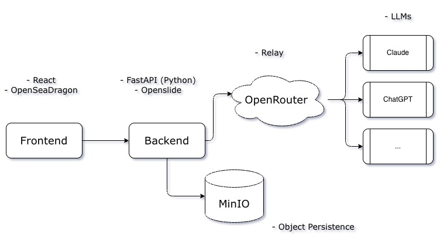

# MRXS Analysis App


## Introduction

MRXS Analysis App loads MIRAX (`.mrxs`) slides, lets you crop an area of interest,
and sends the selected image through OpenRouter to multiple frontier LLMs for
analysis. You can then download a generated PDF report containing the findings.



## Requirements and usage

You need Docker with Docker Compose and a valid OpenRouter API key.

From the repository root, copy the example configuration:

```sh
cp .env.example .env
```

Fill in `OPENROUTER_API_KEY` in `.env`. Populate `ANALYSIS_MODELS` with a
comma-separated list of OpenRouter model IDs that support image input. These
models will be available for individual selection in the frontend.

After starting the app, open `http://localhost:8000` (or the port configured by
`APP_PORT` in `.env`).

1. **Load an image.** Upload a MIRAX slide in the form of a ZIP containing the `.mrxs` and a folder of its
   companion `.dat` files. Use the crop toggle to switch from OpenSeadragon's normal
   navigation to drawing an area of interest. Turn cropping off to resume
   navigation. Alternatively, upload an already cropped JPEG, or a ZIP containing
   multiple JPEG images.
2. **Add a prompt.** Upload a plain-text (`.txt`) file containing the analysis
   instructions.
3. **Select models and analyze.** Choose the models to use and start the analysis.
   Each JPEG image is analyzed separately by every selected model. Multiple
   image/model requests currently run concurrently.
4. **Download the report.** Once analysis completes, download the PDF report with
   the findings.

## Run the app

```sh
docker compose up --build
```

## Run the tests

Run tests from the repository root (Python 3.12 and Node.js 22.22.2+ recommended):

```sh
python3 -m venv .venv
source .venv/bin/activate
python -m pip install -r requirements-test.txt
python -m pytest
python scripts/coverage_badge.py

npm ci --prefix frontend
npm test --prefix frontend
npm run build --prefix frontend
```

## License

MRXS Analysis App is licensed under the [Apache License 2.0](LICENSE).
